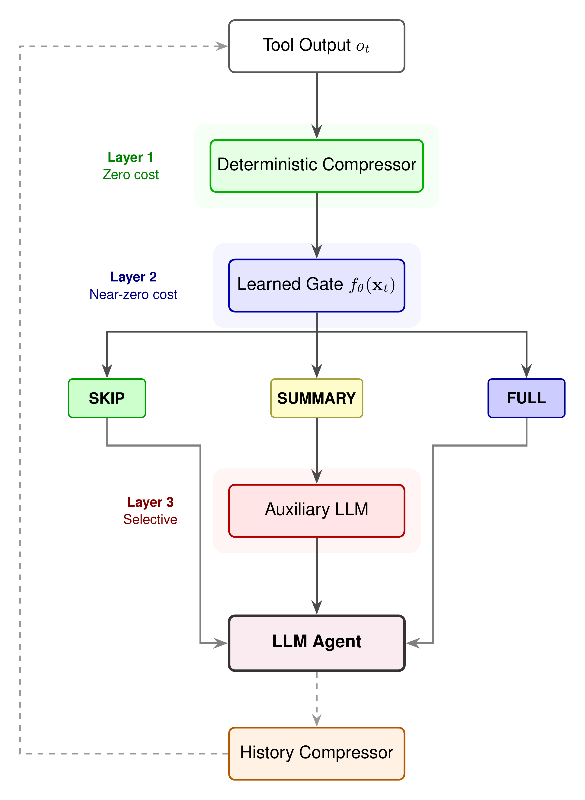

# TROT: Triage of Observation Tokens for Efficient LLM Agents

📄 **Paper:** [OpenReview](https://openreview.net/forum?id=OgkJ87Gu35&noteId=OgkJ87Gu35)

## Abstract

LLM coding agents accumulate large observation histories, including conversations, reasoning traces, tool calls, and tool outputs, causing context windows to grow and inference costs to increase. We present TROT (Triage of Observation Tokens), a hierarchical framework that selectively compresses and removes stale observations using deterministic rules, a lightweight learned gate, and an auxiliary LLM only when needed. On SWE-bench Verified across two model families, TROT achieves the highest task success while substantially reducing context size. It attains a 50.6% resolve rate with 55% token savings on Sonnet-4.6 and a 46.1% resolve rate with 46% token savings on Devstral-24B, while requiring 6× fewer auxiliary LLM calls than uniform LLM-based reflection.

<p align="center">
  
</p>

*Figure: TROT pipeline. Each observation passes through three layers in cost order: a deterministic compressor (zero cost), a learned gate (near-zero cost), and an auxiliary LLM used selectively. The agent sees the result, and the history compressor feeds back into the next step.*

## Method

TROT handles observations in three layers, cheapest first:

1. **Deterministic rules (zero cost).** Veto compression for critical content such as error traces and first-time outputs, and apply pattern-based compression to known waste: stale file re-reads, submit boilerplate, and edit confirmations.
2. **Learned gate (near-zero cost).** Predicts downstream utility from trajectory-state features and chooses SKIP, SUMMARY, or FULL for each observation.
3. **Auxiliary LLM (selective).** Summarizes only the observations the gate marks for summary.

## Baselines and Main Results

We compare against four baselines and the unmodified agent on SWE-bench Verified (89 held-out tasks), using the same agent loop, prompt, tools, and harness for every method.

| Baseline | Description |
|----------|-------------|
| Baseline | Unmodified agent, full observations |
| TACO (Ren et al. 2026) | Self-evolved compression rules with critical-observation bypass |
| AgentDiet (Xiao et al. 2025) | Auxiliary Haiku reflection on observations above a token threshold |
| Truncation | Keeps the start and the error tail of each observation |
| Sliding Window (Lindenbauer et al. 2025) | Masks observations older than M steps with a placeholder |

Resolve rate is the percentage of tasks with a patch that passes the repository's tests. Token savings are relative to the baseline.

| Method | Sonnet-4.6 Resolve % | Tokens | Savings | Devstral-24B Resolve % | Tokens | Savings |
|--------|---------------------:|-------:|--------:|-----------------------:|-------:|--------:|
| Baseline | 45.9 | 647K | | 44.9 | 652K | |
| TACO | 47.1 | 713K | −10% | 43.8 | 592K | +9% |
| AgentDiet | 42.4 | 455K | +30% | 44.9 | 570K | +13% |
| Truncation | 38.8 | 527K | +19% | 41.6 | 580K | +11% |
| Sliding Window | 37.6 | 478K | +26% | 38.2 | 403K | +38% |
| **TROT (ours)** | **50.6** | **289K** | **+55%** | **46.1** | **349K** | **+46%** |

TROT is the only method that achieves both the highest resolve rate and the largest token savings on both models.

## Installation

Python 3.10 or newer.

```bash
pip install -r requirements.txt
```

`xgboost` and `scikit-learn` are pinned to the versions the gate models in `trot/models/` were saved with.

## Quick Start

**1. Build the task file.** The 89 held out SWE-smith tasks are listed in `data/task_ids.json`. This script looks them up in the public [SWE-bench/SWE-smith](https://huggingface.co/datasets/SWE-bench/SWE-smith) dataset:

```bash
python scripts/prepare_tasks.py --out data/tasks.jsonl
```

**2. Set your model provider.** Every method calls the model through the standard `openai` client, so any provider with an OpenAI compatible API works. Credentials come from the environment, never from the config:

```bash
export OPENAI_API_KEY=...
export OPENAI_BASE_URL=...   # optional, for a provider other than OpenAI
```

**3. Run.** Choose the agent and reflection models in [`configs/default.yaml`](configs/default.yaml), then:

```bash
python run_trot.py --config configs/default.yaml
python run_trot.py --methods baseline trot --limit 5   # quick check on 5 tasks
```

For each task, the repository is cloned from GitHub at the task's commit, the bug is injected with the task's mutation patch, and its dependencies are installed. A task is resolved when its FAIL_TO_PASS tests pass. Results go to `results/results.jsonl`, one line per task and method with the full trajectory. Runs already in the file are skipped, so an interrupted run resumes with the same command.

> **Note:** the agent runs shell commands and installs packages inside each task checkout. Run it in a container or a disposable machine.

## Configuration

Every hyperparameter is in [`configs/default.yaml`](configs/default.yaml), and the defaults are the settings used in the paper. The main ones:

| Setting | Default | Description |
|---------|---------|-------------|
| **Agent** | | |
| `model` | `gpt-4.1` | Agent model, as named by your provider |
| `reflect_model` | `gpt-4.1-mini` | Auxiliary model for AgentDiet and TROT reflection |
| `max_steps` | 50 | Agent step budget per task |
| `max_output_tokens` | 4096 | Cap on tokens per agent response |
| **Baselines** | | |
| `truncation.max_chars` | 3000 | Characters kept from each observation |
| `sliding_window.window_size` | 8 | Observations older than this many steps are masked |
| `agent_diet.a`, `.b`, `.theta` | 2, 1, 500 | Reflection target offset, context steps and minimum tokens |
| **TROT** | | |
| `trot.gate.risk_threshold` | 0.15 | Maximum predicted risk allowed for a cheaper tier |
| `trot.reflection.theta` | 3000 | Reflect only on observations above this many tokens |
| `trot.reflection.max_calls` | 5 | Reflection calls allowed per task |
| `trot.history.recency_window` | 5 | Most recent steps never compressed |
| `trot.history.age_decay_threshold` | 15 | Older observations decay to a stub |
| `trot.nudges.start_step`, `.interval` | 15, 8 | When progress nudges begin and how often |
| `trot.submit_gate` | true | Run the failing tests before accepting a submit |
| `trot.ablations` | none | Any of `no_gate`, `no_critical_bypass`, `no_submit_gate`, `no_history_compress`, `no_reflection` |

The paper used Claude Sonnet 4.6 and Devstral Small 24B as agent models, with Claude Haiku 4.5 for reflection.

## File Structure

```
.
├── run_trot.py               # Runs the methods on the tasks
├── configs/default.yaml      # Models, step budget and method parameters
├── scripts/prepare_tasks.py  # Builds data/tasks.jsonl from SWE-smith
├── data/task_ids.json        # The 89 held out task IDs
├── trot/
│   ├── agent.py              # Agent loop, tools, testbeds, TROT and all baselines
│   ├── gate/                 # Learned observation gate (features, allocator, wrapper)
│   └── models/               # Trained gate models, one per tool type
├── tests/                    # Smoke tests (no API calls)
├── figures/pipeline.png
├── requirements.txt
└── LICENSE
```

## Citation

If you use TROT or this code, please cite:

```bibtex
@inproceedings{trot2026,
  title={TROT: Triage of Observation Tokens for Efficient LLM Agents},
  author={Paul Trust},
  year={2026},
  url={https://openreview.net/forum?id=OgkJ87Gu35}
}
```

## Author

Paul Trust ([trustpaul1000@gmail.com](mailto:trustpaul1000@gmail.com))

## License

MIT. See [LICENSE](LICENSE).
